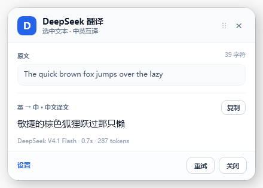
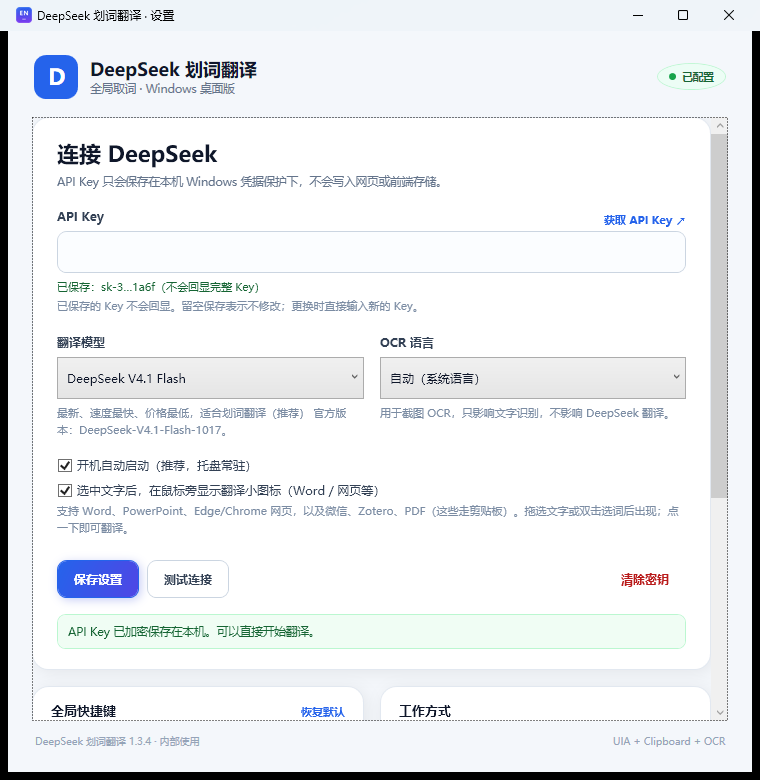

# DeepSeek 划词翻译

用 DeepSeek 翻译 Windows 上任意位置的选中文本：Word、浏览器、PDF、微信、PowerPoint 都可以。

> A lightweight Windows 11 tray app that translates selected text anywhere with the DeepSeek API.



## 功能

- **全局划词**：选中文字后鼠标旁出现「译」，点一下即翻译；也支持全局快捷键。
- **多应用取词**：Word（UIA）、Edge/Chrome 网页与 PDF、PowerPoint、微信、Zotero、Foxit/Acrobat（剪贴板回退）。
- **截图 OCR**：框选屏幕区域识别并翻译（Windows OCR，中/英）。
- **术语表**：每行 `原文=译文`，强制指定译法，例如 `PA=功率放大器`。
- **本地缓存**：相同内容再次翻译直接秒出，不重复计费。
- **流式输出**：边生成边显示，长段落更快看到结果。
- **原文选中 + 单词详解**：选中原文中的单词，查看音标、词性、释义、搭配和本句含义。
- **数学公式正常化**：PDF 里的 LaTeX（`\(\boldsymbol{\Gamma}_{11}\)`）自动转成 `Γ₁₁`。
- **自动更新**：启动检查 Gitee 上的 `latest.json`，校验 SHA256 与签名后静默升级。

## 安装

**Gitee Releases（当前可用）**

[https://gitee.com/hexin1225/deepseek-translator/releases](https://gitee.com/hexin1225/deepseek-translator/releases)

下载 `DeepSeekTranslator-<版本>-setup.exe`，双击安装。按用户安装，不需要管理员权限。

**winget（清单已准备，等待 microsoft/winget-pkgs 合并）**

```powershell
winget install Hexin.DeepSeekTranslator
```

**Microsoft Store（计划中）**

## 使用

1. 首次启动填入 DeepSeek API Key（只保存在本机，DPAPI 加密）。
2. 在任意软件里选中文字，点鼠标旁的「译」，或按 `Ctrl+Alt+E`。
3. 翻译剪贴板：`Ctrl+Alt+V`；截图 OCR：`Ctrl+Alt+O`；复制最近译文：`Ctrl+Alt+C`。
4. 所有快捷键都可以在设置页修改，支持 `Ctrl+C+C` 这类双击式组合。



## 隐私

- API Key 使用 Windows DPAPI（CurrentUser）加密，只存在本机；
- 没有自建服务器，翻译请求直接发往 DeepSeek API；
- 术语表、缓存、日志都在 `%LOCALAPPDATA%\DeepSeekTranslator`，卸载时保留。

## 构建

需要 .NET 8 SDK（Windows）：

```powershell
dotnet build src/DeepSeekTranslator/DeepSeekTranslator.csproj -c Release
powershell -File scripts/test.ps1
```

打包安装程序需要 Inno Setup 6；签名脚本见 `scripts/sign.ps1`。

## 分发

- Gitee：主发布源，`latest.json` 自动更新；
- GitHub：代码镜像（本仓库）；
- winget：清单在 `packaging/winget`；
- Microsoft Store：MSIX 模板与图标见 `packaging/msix`；
- 详细分发/签名步骤见 [docs/DISTRIBUTION.md](docs/DISTRIBUTION.md)。

## 许可证

MIT，见 [LICENSE](LICENSE)。
