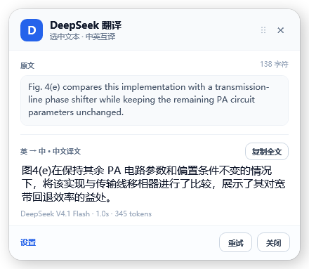

# DeepSeek 划词翻译

一个 Windows 托盘小工具：在网页、Word、PowerPoint、微信、Zotero、PDF 阅读器里选中文字，
按快捷键或点击鼠标旁的「译」图标，由 DeepSeek 自动判断中英方向并翻译。



> A Windows tray app for selection translation: select text anywhere, press a hotkey (or click the
> floating 「译」 icon), and DeepSeek translates it between Chinese and English automatically.

## 特性

- **划词即译**：拖选 / 双击选词后鼠标旁出现「译」图标，点一下翻译，不需要快捷键；
- **全局快捷键**：翻译选区、翻译剪贴板、截图 OCR、复制最近译文，全部可自定义，也支持 `Ctrl+C+C` 这种双击式组合；
- **多来源取词**：Word 走 UI Automation；PowerPoint、微信、Zotero、PDF 走「自动 Ctrl+C + 剪贴板」；浏览器按光标形状即时判断；
- **截图 OCR**：扫描版 PDF、图片、自绘界面手动框选；
- **结果浮层**：可拖动、默认常显、可拖选部分译文复制；
- **多显示器 / 混合 DPI**：按物理像素落位，副屏、负坐标都正确；
- **自动更新**：启动后检查更新清单，校验 SHA256 与签名后静默升级；
- **隐私**：API Key 用 Windows DPAPI 加密保存在本机，只把选中的文字发给 DeepSeek。

## 安装

### 直接下载安装包

到 [Releases](https://gitee.com/hexin1225/deepseek-translator/releases) 下载
`DeepSeekTranslator-<版本>-setup.exe`，双击即可，按用户安装、不需要管理员权限。

> 安装包与自动更新目前托管在 Gitee；本仓库用于源码、Issue 和开发。

### 从源码构建

需要 Windows 10 2004+ 与 [.NET 8 SDK](https://dotnet.microsoft.com/download/dotnet/8.0)：

```powershell
# 在仓库根目录执行
dotnet build src/DeepSeekTranslator/DeepSeekTranslator.csproj -c Release
```

发布自包含版本（输出到 `releases/v<版本>/win-x64`）：

```powershell
powershell -File scripts/build.ps1 -Configuration Release -Publish
```

## 使用

1. 首次启动会打开设置页，填入自己的 [DeepSeek API Key](https://platform.deepseek.com/api_keys)（保存后 DPAPI 加密），点「保存设置」；
2. 在任意软件里选中文字；
3. 按快捷键，或点鼠标旁的「译」图标；
4. 浮层里的译文可以拖选一部分，按 `Ctrl+C` 或右键「复制选中」；「复制全文」复制整段。

| 默认快捷键 | 功能 |
| --- | --- |
| `Ctrl+Alt+E` | 翻译当前选区 |
| `Ctrl+Alt+V` | 翻译剪贴板（管理员窗口 / 手动复制后） |
| `Ctrl+Alt+O` | 截图 OCR 翻译 |
| `Ctrl+Alt+C` | 复制最近一条译文 |

快捷键在「设置 → 全局快捷键」里修改，点「保存设置」立即生效。
如果组合键被其他程序占用，保存时会提示并保留原快捷键。

## 工作原理

```text
全局快捷键 / 鼠标钩子
        │
        ├─ 拖选结束 ─→ 浏览器（I 型光标）/ 微信 / PPT → 直接出「译」图标
        ↓
取词编排
  ├─ 管理员窗口？ → 提示手动 Ctrl+C，再按「翻译剪贴板」
  ├─ UI Automation TextPattern → Word
  ├─ 自动 Ctrl+C + 剪贴板 → 浏览器 / PowerPoint / 微信 / Zotero / PDF
  └─ 截图 OCR → 扫描 PDF / 图片 / 自绘界面
        ↓
LanguageDetector（本地判断中 / 英 / 混排）
        ↓
DeepSeek Chat Completions（deepseek-flash，关闭思考模式）
        ↓
无焦点 WPF 浮层（方向标签 / 可拖选复制 / 重试）
```

## 目录结构

```text
src/DeepSeekTranslator/     主程序（C# / WPF / .NET 8）
  Services/                 取词、翻译、快捷键、托盘、更新
  Views/                    浮层、设置页、截图框选、划词图标
  Controls/                 快捷键录制控件
tests/CoreSmoke/            校验、方向检测、快捷键解析、API 模拟
tests/CaptureSmoke/         UIA、剪贴板、快捷键注册、渲染
scripts/                    构建、测试、签名、打包、发布
installer/                  Inno Setup 安装脚本
docs/                       截图
```

## 常见问题

**管理员窗口读不到？**
Windows 不允许普通权限进程给高权限窗口发送按键。请手动 `Ctrl+C` 后按「翻译剪贴板」，
或以管理员身份运行本程序。

**PowerPoint 里没有反应？**
先双击文本框进入文字编辑（看到闪烁光标）再拖选；放映模式下没有文本选区，
可以改用截图 OCR。

**浏览器里图标不出现？**
拖动链接、图片、标签页时不会出现；选中文字后松手应立刻出现。
如果浏览器以管理员身份运行、而本程序没有，取词会失败——请以管理员身份重启本程序。

**SmartScreen 提示“未知发布者”？**
安装包使用内部自签证书签名，属正常现象；对外分发需要正式代码签名证书。

## 开发

```powershell
# 构建 + 全部冒烟测试 + Windows OCR 自检
powershell -File scripts/test.ps1
```

诊断参数：

```text
--settings        启动后直接打开设置页
--demo-overlay    不调用 API，展示一次示例浮层
--ocr-selftest    测试 Windows OCR 后退出
--ui-preview      把浮层和划词图标渲染成 PNG 后退出
DEEPSEEK_TRANSLATOR_DEBUG=1  输出窗口定位调试日志
```

日志目录：`%LOCALAPPDATA%\DeepSeekTranslator\logs\app.log`

## 已知限制

- 只支持 Windows 11 x64（Windows 10 2004+ 可用），不支持 macOS；
- 管理员窗口需要手动复制，不做自动提权；
- 受 DRM 保护的 PDF 无法读取；
- PowerPoint 放映模式、微信语音/视频不在范围内；
- 自签证书对公网分发仍会显示“未知发布者”。

## License

[MIT](LICENSE)
