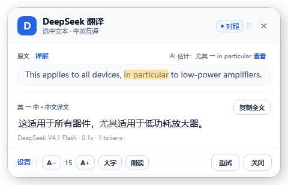

# 译文选词 → 原文高亮（v1.9.1）

## 使用

1. 先完成一次翻译。
2. 开启标题栏右侧的轻量 **「对照」** 胶囊开关；设置页也有同名选项。默认关闭，开关状态会保留。译文上方不再有常驻卡片。
3. 在译文里选择一个词或短语，松开鼠标并停顿约 **650 毫秒**。
4. 对应原文以 **琥珀色** 标出；原文标题行只在选词后显示轻量提示，例如 **AI 估计：尤其 → in particular**。若原文较长，内层原文区域会滚到第一处对应位置；点击「查看」可将原文区域带入视野。
5. 没有选词时原文标题行只显示字符数，不显示常驻说明；原文高亮不会抢焦点，不修改译文选区、复制行为或原文内容；原文选词详解仍可使用。



上图为公开测试句的合成界面示例，不含用户剪贴板或个人文档；该对应关系也已用真实 API 独立验证。

## 为什么不是逐词绑定

中英翻译存在一对多、多对一、换序、省略和意译。“尤其”可以对应 `in particular`，一个英文动词短语也可能对应一整段中文，甚至不存在可独立对应的词。本功能是 **AI 估计的短语对齐，不保证语义正确**，并不是精确的双语词典索引。

- 支持一处或多处、不连续的原文片段，最多 5 处。
- 模型必须返回原文中的逐字引文；程序再用紧邻上下文确定唯一位置，不信任模型生成的字符偏移。
- 原文里出现多次相同短语、但上下文仍无法唯一定位时，不猜第一处。
- 低置信、无对应、引文不存在、范围过宽、响应不完整时不高亮，保留清楚的提示。
- Unicode/emoji/组合字符和 CRLF 换行采用精确的 UTF-16/文本元素边界校验。

## 请求、费用与隐私

- **默认关闭**。启用本身不会上传原有选区；此后稳定选词才发起额外的 DeepSeek API 请求，可能产生额外费用。
- 发送当前完整原文、当前完整译文、选中文字及其位置和附近上下文；凭据仍使用本机 DPAPI 保存的 Key，通过 Authorization 请求头发送。
- 鼠标按住拖选或 Shift 扩选期间不请求；650ms 内快速换选区合并为一次。新选区、重新翻译、隐藏/关闭、关闭功能时取消旧请求，过期结果和错误不能覆盖新内容。
- 最多 64 条 **仅内存 LRU 缓存**，按完整原文、译文、选区位置和模型区分；重复选词不重复计费。没有把对齐内容写入日志或磁盘，也没有把 Key 放进缓存。
- 关闭功能、清理诊断缓存或退出应用会清理对齐缓存；不后台预先对齐整篇文章。
- 原文上限 8000 字符、译文上限 40000 字符、单次选择上限 400 字符。请求超时为 25 秒。

完整数据说明见 [隐私说明](<../PRIVACY.md>)。

## 实现位置

- [请求模型与 Unicode 边界](<../src/DeepSeekTranslator/Models/TextAlignmentModels.cs>)
- [DeepSeek 请求与严格引文解析](<../src/DeepSeekTranslator/Services/DeepSeekClient.Alignment.cs>)
- [有界内存缓存与串行请求](<../src/DeepSeekTranslator/Services/TextAlignmentService.cs>)
- [浮层选区、防抖和代次保护](<../src/DeepSeekTranslator/Views/OverlayWindow.Alignment.cs>)
- [标题栏轻量开关与原文行结果布局](<../src/DeepSeekTranslator/Views/OverlayWindow.xaml>)
- [不抢焦点的多片段高亮绘制](<../src/DeepSeekTranslator/Views/AlignmentHighlightAdorner.cs>)

## 测试

离线服务回归测试包含在 CoreSmoke；界面生命周期回归包含在 CaptureSmoke。两者不需要真实 Key。

```powershell
dotnet build tests/CoreSmoke/CoreSmoke.csproj -c Release --no-incremental
dotnet run --project tests/CoreSmoke/CoreSmoke.csproj -c Release --no-build
# 先退出已安装托盘程序，避免 CaptureSmoke 的全局快捷键被占用
dotnet run --project tests/CaptureSmoke/CaptureSmoke.csproj -c Release
```

可选的真实 API 公开示例（只在显式传入 `--live` 时读取本机 Key，执行一次收费请求）：

```powershell
dotnet run --project tests/AlignmentLiveSmoke/AlignmentLiveSmoke.csproj -c Release -- --live
```

已实测的公开示例：

- 原文：`This applies to all devices, in particular to low-power amplifiers.`
- 译文：`这适用于所有器件，尤其适用于低功耗放大器。`
- 选择：`尤其`；真实返回：`in particular`。

## 后续建议

目前优先保证“选中后再查询”的费用可控与结果可校验。以后可以加入反向对照（原文选词 → 译文高亮）和句子级对照模式；不建议在每次翻译时默认追加整篇词级对齐，成本和误对齐都会明显增加。

## 验收记录（2026-11-12）

- CoreSmoke 全部通过：包括对齐解析、重复短语、Unicode、缓存、取消、过期结果、旧设置默认关闭等回归；真实 Key 未覆盖。
- CaptureSmoke 服务与界面回归通过：保留焦点/选区、尾部全文定位、多片段、无匹配清理、生命周期隔离等，并检查渲染图原文区域确有琥珀色像素。通用剪贴板读写测试改为显式启用，默认跳过，避免修改用户剪贴板。
- 真实 DeepSeek API 的公开示例通过：`尤其` 对应 `in particular`；未使用私人文档。
- 编译 0 错误；离线 NuGet 源不可达时出现 NU1900 警告，不影响签名产物。安装包采用原有内部自签证书，签名状态 Valid，不是公开受信任的正式证书。
- 安装包大小 53,516,440 字节，SHA256：`666d5ffeeff216539e9737027c57db1e801b7eb89aeaf20b7bfb4bc4c1d0ec43`。
- 本机安装程序退出码 0，已安装 1.9.1；安装后的 EXE/DLL 与签名后的发布目录哈希一致，进程已启动并保持运行。
- 额外尝试的安装版 UIAutomation 自动选词探针因演示浮层已自动隐藏而未完成，未发送额外 API 请求；不把该探针记作端到端通过。以上服务实测、界面回归和安装验证均已独立完成。
- 本次临时脚本及新建真实 API 测试的编译中间目录已清除，保留源码、截图、文档和安装包。1.9.1 已发布到 [Gitee](<https://gitee.com/hexin1225/deepseek-translator/releases/tag/v1.9.1>) 和 [GitHub](<https://github.com/hxxhxhxx/deepseek-translator/releases/tag/v1.9.1>)，自动更新清单同步更新。

